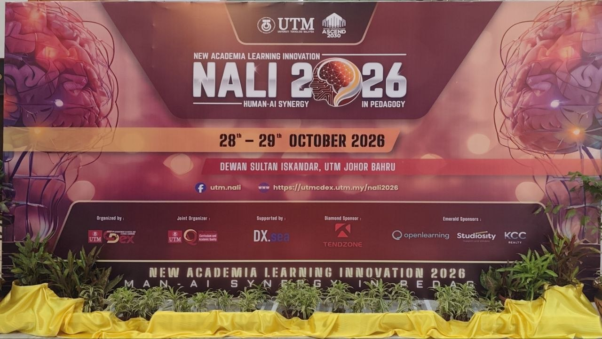

# 🎓 NALI 2026: New Academia Learning Innovation

### Theme: Human-AI Synergy in Pedagogy

📍 **Location:** Dewan Sultan Iskandar, Universiti Teknologi Malaysia (UTM), Johor Bahru

📅 **Date:** 28–29 October 2026

---

## 📌 Event Overview

NALI 2026 (New Academia Learning Innovation) provided an opportunity to explore innovative approaches to teaching and learning through technology.

The event showcased various educational innovations that integrate Artificial Intelligence (AI), digital systems, interactive learning methods, and Information and Communication Technology (ICT) into modern education.

During this event, I explored five educational ICT innovations and learned how technology can improve teaching effectiveness, student engagement, assessment processes, and information management.

## 🎯 Objectives of the Activity

- Understand how Artificial Intelligence can support modern education.
- Explore real-world applications of Information and Communication Technology (ICT).
- Learn how innovative systems address educational challenges.
- Understand the importance of human involvement in AI-assisted processes.
- Relate classroom concepts from SECP1513 to practical technology implementations.

---

## 🔬 Featured Innovator Projects

During NALI 2026, I explored five innovative projects that demonstrate different applications of technology in education and other fields.

### 1. 🌊 SeaClear

**Lead Innovator:** Dr. Nurfazira Mohamed Fadil & Team

**Main Focus:** Marine Data Analysis and Anomaly Detection

SeaClear is an interactive MATLAB-based hydrographic data processing project that works with real marine survey data from Forest City and Bintulu.

The project demonstrates how computational techniques can help identify unusual patterns in marine survey measurements.

**Technical Highlights:**
- Uses MATLAB for interactive data processing.
- Processes real marine survey datasets.
- Applies Median Absolute Deviation (MAD) filtering.
- Identifies sea-spike anomalies in marine data.

**What I Learned:**

This project demonstrated how programming and data analysis can be applied beyond traditional software development. It also highlighted the importance of data accuracy and identifying unusual data patterns.

---

### 2. 🧩 Design-Switch-Mark & Flexible Vodcast

**Lead Innovator:** ChM Dr. Nur-Fadhilah Mazlan

**Main Focus:** Interactive Learning and AI-Assisted Content Creation

This innovation combines peer-based puzzle design and assessment with AI-assisted vodcast scripting.

It demonstrates how students can participate actively in learning activities while using AI as a supporting tool for educational content creation.

**Technical Highlights:**
- Peer-designed puzzle activities.
- Interactive learning and assessment.
- AI-assisted vodcast scripting.
- Human validation of scientific information.

**What I Learned:**

AI can support the creation of educational materials, but human verification remains important to ensure that the information is accurate and reliable.

---

### 3. 🤖 AI Math Detective

**Lead Innovator:** Dr. Hafizah Farhah Saipan Saipol (MJIIT)

**Main Focus:** Artificial Intelligence and Critical Thinking

AI Math Detective introduces deliberately incorrect AI-generated mathematical derivations to encourage students to identify mistakes and evaluate the correctness of solutions.

Instead of accepting AI-generated answers immediately, students are encouraged to analyse and verify the information.

**Technical Highlights:**
- AI-generated mathematical derivations.
- Identification of incorrect solutions.
- Critical thinking and error detection.
- Reported student satisfaction: 4.39/5.

**What I Learned:**

Artificial intelligence is not always correct. Users must develop critical thinking skills and verify AI-generated information instead of depending on it completely.

---

### 4. 🎤 PITCH Framework

**Lead Innovator:** Dr. Mazilah Abdullah & Team (FM)

**Main Focus:** Human-AI Accountability and Student Assessment

The PITCH Framework introduces a five-stage approach to integrating AI into learning while maintaining student accountability.

The framework includes Pecha Kucha presentations and a three-minute unassisted oral defence.

**Technical Highlights:**
- Five-stage human-AI accountability framework.
- Pecha Kucha presentation method.
- Three-minute unassisted oral defence.
- Reported CLO1–PLO1 improvement: +8.71%.

**What I Learned:**

AI can assist students in preparing academic work, but students must still understand their content and be able to explain their ideas independently.

---

### 5. 📚 QDBS PBD

**Lead Innovator:** Cikgu Adifazrun bin Mohamad & Team

**Main Focus:** Digital Assessment and Educational Information Management

QDBS PBD demonstrates an offline-first school assessment system that connects multimedia student learning artifacts through QR codes.

The system aims to simplify the management of student assessment information and reduce administrative work.

**Technical Highlights:**
- Offline-first assessment system.
- QR-code-based multimedia integration.
- Digital student assessment management.
- Reported administrative workload reduction: approximately 70%.

**What I Learned:**

A well-designed information system can improve efficiency by organising information and reducing repetitive administrative tasks.

---

## 🧠 Key Learning Outcomes

Through my participation in NALI 2026, I gained a better understanding of several important concepts.

| Learning Area | What I Learned |
|---|---|
| Artificial Intelligence | AI can support education, but human verification remains important. |
| Information Systems | Digital systems can improve information management and operational efficiency. |
| Data Processing | Data filtering and anomaly detection help improve data reliability. |
| Human-AI Collaboration | Humans must maintain accountability when using AI tools. |
| Technology Applications | Computing techniques can solve practical problems in different industries. |

---

## 💭 Personal Reflection

Participating in NALI 2026 was a valuable learning experience that allowed me to explore how technology is applied in real-world situations.

One of my biggest takeaways was that Artificial Intelligence should be treated as a supporting tool rather than a replacement for human thinking.

The five innovator projects demonstrated that technology can improve productivity, simplify processes, and support decision-making. However, human judgement, accuracy, accountability, and ethical considerations remain essential.

As a Computer Science student specialising in Computer Networks and Security, this experience encouraged me to explore emerging technologies and develop the technical knowledge needed for my future career.

---

## 📸 Event Gallery

[NALI 2026 Poster](assets/poster1.jpeg)
[NALI 2026 Interview](assets/interview.png)

*More event photographs and learning materials will be added soon.*

---

---

## 🏁 Conclusion

NALI 2026 provided an opportunity to understand how Artificial Intelligence and Information and Communication Technology can contribute to modern education.

Through exploring different innovations, I gained a broader perspective on the importance of human-AI collaboration, information management, and responsible technology usage.

This experience has motivated me to continue learning, improving my technical skills, and exploring how technology can be used to solve real-world challenges.

**Learning Today, Innovating Tomorrow.**
